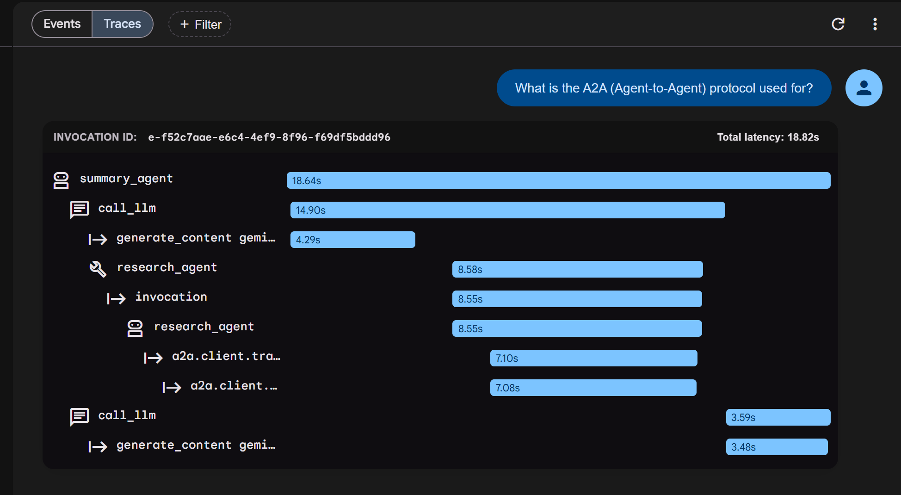
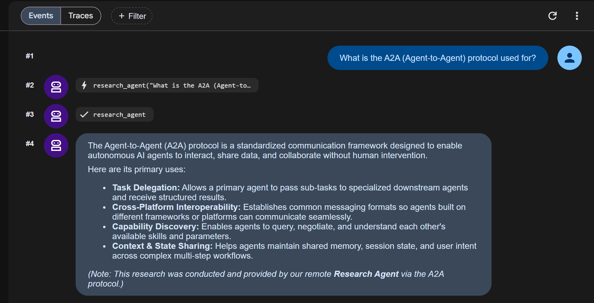

# Research → Summary Agents over A2A

[](https://github.com/usmanshah904/adk-a2a-multi-agent/actions/workflows/tests.yml)


Two **Google ADK** agents, both powered by **Gemini**, that run as **separate processes** and collaborate over the
**A2A (Agent-to-Agent) protocol**: real HTTP / JSON-RPC between services, not a Python function call.

The user talks to a **Summary Agent**. It delegates every research question to a remote **Research Agent**, receives a
structured research brief over A2A, and replies with its own concise summary.



## Demo

A real run in the ADK web UI. The **trace** shows the Summary Agent's model call, the `research_agent` tool call, and
inside it the `a2a.client` transport spans: the request really leaves the process and goes over A2A to the Research
Agent before the Summary Agent writes its answer.



The same run as **events**: the question, the `research_agent` call, its result, and the final summary.



## How it works

| Piece | What it does |
| --- | --- |
| **Research Agent** (`research_agent/`) | A plain ADK `Agent`. `server.py` wraps it with `to_a2a(...)`, which exposes an A2A JSON-RPC endpoint and publishes the standard **Agent Card** at `/.well-known/agent-card.json`. It returns a brief with *Overview*, *Key Points* and *Considerations*. |
| **Summary Agent** (`summary_agent/`) | The user-facing ADK `Agent`. It holds a `RemoteA2aAgent` (pointed at the Research Agent's Agent Card) wrapped in an `AgentTool`, so the model can call it like a tool. It never imports the Research Agent's code; it only knows a URL. |
| **A2A** | The transport between them: the Summary Agent reads the Agent Card to discover the remote agent, then sends `message/send` requests over HTTP. |

Flow: **User → Summary Agent → A2A (HTTP JSON-RPC) → Research Agent → research brief → Summary Agent → answer.**

### Why A2A instead of a direct function call

- **Process isolation:** the Research Agent can be developed, deployed, scaled or owned by another team independently.
- **Framework-agnostic:** any A2A-compliant client can call it, and the Summary Agent can call any A2A agent.
- **Standard discovery:** the Agent Card describes the agent, so the caller needs only its URL, not its internals.

## Tech stack

Python 3.11+ · Google ADK 2.8 · Gemini · A2A SDK · Uvicorn / Starlette · pytest · GitHub Actions

## Getting started

```bash
git clone https://github.com/usmanshah904/adk-a2a-multi-agent.git
cd adk-a2a-multi-agent

python -m venv .venv
# Windows: .venv\Scripts\activate   macOS / Linux: source .venv/bin/activate
pip install -r requirements.txt

cp .env.example .env    # then add your Gemini API key
```

Get a free Gemini API key at [Google AI Studio](https://aistudio.google.com/apikey). `.env` is git-ignored; never commit it.

### Run it

The start script launches the Research Agent server, waits until its Agent Card is reachable, runs the Summary Agent,
and stops the server when you exit.

```bash
./start.sh          # ADK web UI at http://localhost:8000 (pick "summary_agent")
./start.sh run      # chat in the terminal
./start.sh e2e      # live end-to-end A2A test
```

On Windows PowerShell use `.\start.ps1`, `.\start.ps1 run` or `.\start.ps1 e2e`.

Try asking: *"What is the A2A (Agent-to-Agent) protocol used for?"*

<details>
<summary>Run the two processes by hand instead</summary>

```bash
# Terminal 1: Research Agent A2A server
uvicorn research_agent.server:a2a_app --host localhost --port 8001
curl http://localhost:8001/.well-known/agent-card.json   # check the Agent Card

# Terminal 2: Summary Agent
adk web            # or: adk run summary_agent
```

</details>

### Configuration

All settings are optional except the API key. Put them in `.env`.

| Variable | Default | Purpose |
| --- | --- | --- |
| `GOOGLE_API_KEY` | (required) | Gemini API key |
| `GEMINI_MODEL` | `gemini-3.5-flash` | Model used by both agents |
| `RESEARCH_AGENT_HOST` | `localhost` | Host the Research Agent server binds to |
| `RESEARCH_AGENT_PORT` | `8001` | Port of the Research Agent server |
| `RESEARCH_AGENT_URL` | `http://localhost:8001` | Where the Summary Agent finds the Research Agent |

## Tests

```bash
pip install -r requirements-dev.txt
pytest -v
```

- **`tests/` (offline, runs in CI):** checks the agent wiring (the Summary Agent's only tool is a `RemoteA2aAgent`,
  not an import of the Research Agent) and starts the A2A app in-process to confirm it publishes a valid Agent Card.
  No API key or network needed.
- **`test_e2e.py` (live):** with the Research Agent server running, sends a real question through the Summary Agent and
  asserts that a `research_agent` tool call and its response actually happened over A2A before the final answer.
  Uses your Gemini key. Run it with `./start.sh e2e`.

## Project structure

```
├── research_agent/
│   ├── agent.py        # Research Agent (ADK, Gemini)
│   └── server.py       # exposes it over A2A with to_a2a(); Agent Card
├── summary_agent/
│   └── agent.py        # Summary Agent; calls the Research Agent via RemoteA2aAgent
├── tests/              # offline tests (CI)
├── test_e2e.py         # live end-to-end A2A test
├── docs/               # architecture diagram, screenshots
├── start.sh / start.ps1
└── .env.example
```

> Google ADK marks its A2A integration as experimental, so you may see `[EXPERIMENTAL]` warnings. They are expected.

## License

[MIT](LICENSE) © 2026 Usman Shah
